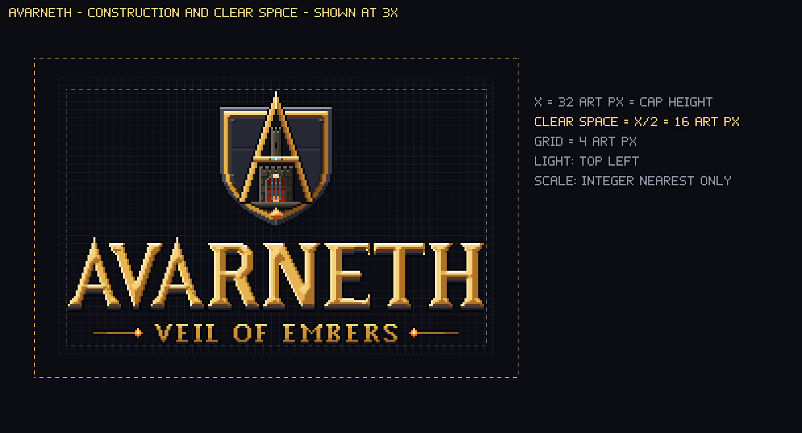
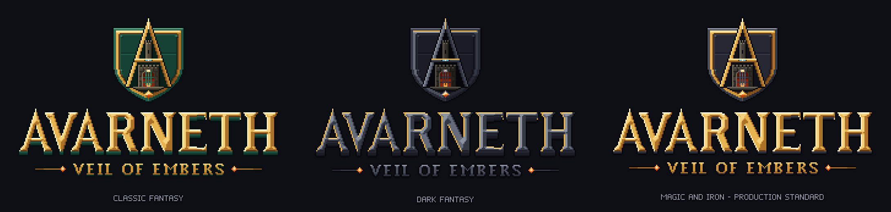

# AVARNETH: VEIL OF EMBERS – Brand Guidelines V1.0

Entwickler & Publisher: **Eckertengineering** · Spielmarke: **AVARNETH: VEIL OF EMBERS** · Kurzbezeichnung: **AVE**

> Der frühere interne Projektname WOE („World of Eckertengineering“) bleibt ausschließlich interner
> Entwicklungsname (Verzeichnisse, Namespaces, Szenen, Nakama-IDs). Er erscheint in **keinem** der hier
> gelieferten Grafik-Assets und darf nicht als sichtbarer Spieltitel verwendet werden.

## 1. Markenarchitektur

| Ebene | Element | Rolle |
|---|---|---|
| Studio | **ECKERTENGINEERING** / „ECKERTENGINEERING PRESENTS“ | dezent, Stahlgrau, eigene 7-px-Pixel-Versalien; konkurriert nie mit dem Titel |
| Spielmarke | **AVARNETH** | dominante Wortmarke, Altgold mit Eisen-Extrusion |
| Untertitel | **VEIL OF EMBERS** | deutlich kleiner (9-px-Versalien), Gold, flankiert von Glut-Rauten; eigener Layer |
| Bildmarke | **Wappen „Das Glut-Tor“** | eigenständig verwendbar (Icon, Favicon, Siegel, Ladeindikator-Deko) |

Alle Elemente liegen getrennt vor (Wortmarke, Untertitel, Wappen, Publisher) und können frei kombiniert
werden; der Untertitel ist separat ein- und ausblendbar.

## 2. Konzept – „Das Glut-Tor“

* **Schild:** geschmiedeter Wappenschild – Außenrahmen aus dunklem Eisen, Innenrand aus Altgold mit Nieten,
  das Feld eine genietete Eisenplatte mit Plattenfuge.
* **Das A als Festungsrahmen:** Zwei goldene Flanken bilden das **A** von AVARNETH; ihr Gipfel durchbricht den
  Schildrand nach oben. Im oberen Innenraum steht ein **schlanker Bergfried** mit drei Zinnen und einer dunklen
  Schießscharte; der goldene Querbalken ist der **Sturz**, in den eine **arkane Rune** eingelassen ist (der einzige
  kühle Magie-Akzent).
* **Torbau:** unter dem Sturz ein rechteckiger, zinnenbewehrter Torbau aus Quadermauerwerk, durch einen dunklen
  Raum von den A-Schenkeln getrennt; darin das **eiserne Fallgitter** (Stäbe mit Spitzen) vor dunkler Glut mit
  hellem Kern am Torfuß.
* **Glutstein:** klein und bündig in die Schildspitze gesetzt – das Siegel der Marke.

Industrielle Fantasy (Schmiede, Eisen, Nieten, Glut) ohne Science-Fiction-Anmutung; keine Neonfarben.
Licht kommt immer von oben links; alle Flächen sind regionsweise monoton schattiert (kein Pixelrauschen).

## 3. Logo-Varianten

| Variante | Datei (1080p-Export ×4) | nativ (1×) | ×4 |
|---|---|---|---|
| A – Hauptlogo (Wortmarke) | `01_Brand_Identity/AVARNETH_Logo.png` | 221×47 | 884×188 |
| A – Hauptlogo mit optionalem Wappen | `01_Brand_Identity/AVARNETH_Logo_With_Emblem.png` | 221×123 | 884×492 |
| B – Vollständiger Titel mit Wappen | `01_Brand_Identity/AVARNETH_Complete_Logo.png` | 221×141 | 884×564 |
| C – Publisher-Präsentation | `01_Brand_Identity/AVARNETH_Publisher_Presentation.png` | 221×158 | 884×632 |
| D – Wappen / Emblem | `01_Brand_Identity/AVARNETH_Emblem.png` | 71×80 | 284×320 |
| Untertitel (mit Glut-Ornamenten) | `01_Brand_Identity/AVARNETH_VeilOfEmbers.png` | 193×22 | 772×88 |
| Untertitel (ohne Ornamente) | `01_Brand_Identity/AVARNETH_VeilOfEmbers_Plain.png` | 135×22 | 540×88 |
| Publisher-Zeile | `01_Brand_Identity/Eckertengineering_Presents.png` | 124×16 | 496×64 |
| Publisher-Kennung | `01_Brand_Identity/Eckertengineering.png` | 101×16 | 404×64 |

* `Source_Files/native_1x/` = Pixel-Master (1 Kunst-Pixel = 1 Bildpixel), `exports_2x/`, `exports_8x/` für andere Zielgrößen.
* Die Wortmarke ist **keine Schrift**: alle Buchstaben sind eigens konstruiert (3:1-Diagonalen bei A/V, 2:1 bei N/R,
  spitze Sporn-Serifen, Turmspitzen-A als Echo des Wappens). A, V, T und H sind pixelgenau spiegelsymmetrisch;
  die Abstände sind optisch ausgeglichen (mittlerer Buchstabenabstand ≈ 7 Kunst-Pixel). Oberfläche: gemeißelte
  Gold-Facetten, Kantenfarben nach echter Kantennormale (durchgehende Lichtkante links, Schattenkante rechts),
  2-px-Extrusion aus dunklem Eisen, 1-px-Kontur.
* Untertitel: eigene 9-px-Kapitälchen in der Konstruktionslogik der Wortmarke, eine Tonstufe ruhiger als AVARNETH,
  flankiert von einer geschmiedeten Linie mit Glut-Raute.
* Publisher: eigene 5-px-Versalien mit 1-px-Strich in einem einzigen flachen Stahlton – bewusst zurückhaltend.

## 4. Schutzzone und Mindestgrößen

* **Maßeinheit X** = Versalhöhe der Wortmarke = 32 Kunst-Pixel (1×).
* **Schutzzone:** mindestens ½ X (16 Kunst-Pixel) rund um jede Logo-Variante frei von anderen Elementen.
* **Wortmarke:** nie kleiner als nativ 1× (221×47 px). Für kleinere Flächen das Wappen bzw. die Icons verwenden.
* **Wappen:** nativ 71×80 px; für 48/64 px die Icon-Fassung (`03_Windows_Icons/AVARNETH_48/64.png`),
  darunter ausschließlich die pro Größe gezeichneten Kleinst-Fassungen (42, 40, 36, 32, 30, 28, 24, 20, 16 px).
* **Helle Hintergründe:** Lockups mit Untertitel/Publisher nie direkt auf hellen Grund setzen – immer auf dunkler
  Fläche oder mit dem Abdunkelungs-Layer (die 1-px-Konturen sind für dunkle Szenen ausgelegt).
* **Untertitel** nie ohne Wortmarke als Spieltitel verwenden; immer unterhalb und kleiner als AVARNETH.

## 5. Farben

Alle Marken-Pixel verwenden ausschließlich diese Master-Palette (Rampen dunkel → hell). Dateien:
`01_Brand_Identity/Source_Files/palette/` (`.gpl` für Aseprite/GIMP/Krita, `.hex`, Code-Tabelle, Farbfeld-PNG).

| Rampe | Rolle | Farben |
|---|---|---|
| **iron** (10) | Dunkles Eisen / Anthrazit – Rahmen, Konturen, Extrusion, Schildfeld | `#07070b` `#111219` `#1b1c25` `#262833` `#353845` `#4a4e5d` `#666b7b` `#8d92a1` `#b9bdc8` `#e3e5ea` |
| **gold** (10) | Altgold / warmes Metall – Wortmarke, Schildrand, A-Flanken, Untertitel | `#1d0f05` `#3a1f0a` `#5e3512` `#87511c` `#ad7128` `#cd9437` `#e6b552` `#f4d27e` `#fdebb0` `#fffbe6` |
| **stone** (8) | Dunkler Naturstein – Bergfestung, Mauern, Sockel | `#0e0d0b` `#1a1815` `#25221e` `#322e29` `#423d36` `#554f46` `#6c655a` `#878073` |
| **ember** (9) | Glut / Funken – Tor-Kern, Glutstein, Partikel, glühende Kanten (sparsam) | `#2a0903` `#561406` `#8a230a` `#c1390e` `#e85d17` `#ff8b2b` `#ffb457` `#ffd892` `#fff1d0` |
| **arcane** (8) | Arkanes Blau – Fenster der Festung (sehr sparsam, Kontrastakzent) | `#06111f` `#0c2440` `#153b66` `#215c92` `#3584be` `#5eb2e0` `#9fdcf6` `#e0f7ff` |

Lichtrichtung in allen Assets: **oben links**. Konturen: `iron0` (#07070b). Keine Verläufe außerhalb der Rampen.

## 6. Pixel-Art-Regeln

1. Skalierung nur ganzzahlig mit Nearest Neighbour (×2, ×3, ×4, ×8 …). Niemals bilinear/bikubisch.
2. Keine Drehung (außer 90°-Schritte), keine Verzerrung, keine nachträglichen Filter, Schlagschatten oder Glows –
   Licht- und Glut-Effekte nur über die gelieferten Effekt-Layer.
3. Hintergründe: bevorzugt dunkel (Anthrazit, Nachtlandschaft). Auf hellen/unruhigen Flächen den mitgelieferten
   Abdunkelungs-Layer (`AVE_Veil`) oder eine dunkle Fläche hinterlegen.
4. Unity-Import: Filter **Point (no filter)**, Kompression **None**, Mip Maps **aus** (Details: `ANIMATION_SPECIFICATION.md`).

## 7. Do & Don’t

| Do | Don’t |
|---|---|
| Wortmarke dominant, Untertitel klein darunter | Untertitel größer oder gleich groß wie AVARNETH |
| Publisher dezent und getrennt | ECKERTENGINEERING in Gold oder größer als der Untertitel |
| Ganzzahlige Skalierung | 150 %-Skalierung mit Glättung |
| Wappen allein als App-/EXE-Icon | Die lange Wortmarke als Icon |
| Dunkler Hintergrund oder Veil-Layer | Logo direkt auf hellem, detailreichem Grund |
| Bezeichnung „AVARNETH: VEIL OF EMBERS“ | „WOE“, „World of Eckertengineering“ als Titel |

## 8. Designrichtungen

Alle drei Richtungen teilen bewusst exakt dieselbe Geometrie (der Brief verlangt, dass sie auf derselben
Markenidentität beruhen) – sie sind **Material- und Farbwelten**, keine abweichenden Logo-Konzepte: exaktes
Paletten-Remapping (jedes Pixel bleibt eine Palettenfarbe) plus eigene Extrusionstiefe.
Übersicht: `02_Logo_Variants/Variants_Overview.png`.

| Richtung | Ordner | Charakter |
|---|---|---|
| **Magic & Iron (Produktionsstandard)** | `02_Logo_Variants/Magic_And_Iron/` | Produktionsstandard – magische Eisen-/Schmiede-Fantasy: dunkles Eisen, Altgold, Glut, arkanes Blau; schlanke 2-px-Extrusion. |
| Classic Fantasy | `02_Logo_Variants/Classic_Fantasy/` | Klassische Fantasy – grünspan-patinierte Bronzeplatten mit hellem Gold und warmem Stein; 3-px-Extrusion in Patina. |
| Dark Fantasy | `02_Logo_Variants/Dark_Fantasy/` | Dunkle, monumentale Fantasy – geschwärztes Eisen, Gold nur an den Lichtkanten, Glut im Tor; schwere 4-px-Extrusion. |

**Produktionsstandard ist „Magic & Iron“** – er ist vollständig animiert, als Unity-Assets exportiert und in allen
Vorschauen verwendet. Die beiden anderen Richtungen liegen als statische Alternativen vor.

## 9. Windows-Icon

`03_Windows_Icons/AVARNETH.ico` enthält **22 Größen**: 16, 20, 24, 28, 30, 32, 36, 40, 42, 48, 56, 60, 64, 72, 80, 84, 96,
120, 128, 144, 192, 256 px (bis 96 px als 32-bit-DIB mit Alpha und AND-Maske, ab 120 px PNG-komprimiert). Damit muss
Windows bei 100/125/150/175/200 % Skalierung und in den „Große Symbole“-Ansichten nicht weichzeichnen.

* 16, 20, 24, 28, 30, 32, 36, 40, 42 px: pro Größe auf dem Pixelraster gezeichnete Kleinst-Fassung – ein geschlossener
  Schild mit mittelgrauer Eisenplatte (bleibt auf dunkler Taskleiste sichtbar), beide A-Schenkel klar golden, Rune im
  Querbalken, ab 28 px Bergfried mit Schießscharte, Tor mit Glut nur am Fuß; keine Funken.
* 48/64 px: Icon-Fassung des Wappens (hellere Platte und rechte Seite).
* Alle übrigen Größen sind exakte Ganzzahl-Vielfache der feineren Zeichnungen: 56 = 28×2, 60 = 30×2, 72 = 36×2,
  80 = 40×2, 84 = 42×2, 96 = 48×2, 120 = 30×4, 144 = 36×4, 192 = 48×4, 128/256/512/1024 = 64×2/4/8/16.
* **Wichtig für die Spiel-EXE:** Unity erzeugt das EXE-Icon nur aus den Icon-Slots der Player Settings (wenige Größen);
  für ein EXE-Icon ohne Weichzeichnung siehe den optionalen Release-Schritt in `PLAYER_SETTINGS.md` (ICO ins EXE schreiben).
* PNG-Einzeldateien: 16/24/32/48/64/128/256/512 im Hauptordner, alle übrigen Größen (inkl. 1024) in `Extra/`.
